# Defend The Tenant – Phase 1 · Tenny McTenantFace

## Introduction

The work is part of the Microsoft Defend The Tenant challenge. Phase 1 secures a preconfigured Microsoft 365 tenant (Contoso); Phase 2 turns these controls into a customer-focused hardening plan. These 10 security controls were configured:

| # | Control | Location | Result |
| --- | --- | --- | --- |
| 01 | Require MFA for admins | Entra ID → Conditional Access | `CA001` On |
| 02 | Enforce MFA for everyone | Entra ID → Conditional Access | `CA002` On |
| 03 | Block legacy authentication | Entra ID → Conditional Access | `CA003` On |
| 04 | Challenge risky sign-ins | Entra ID → Conditional Access | `CA004` On |
| 05 | Remediate high-risk users | Entra ID → Conditional Access | `CA005` On |
| 06 | Restrict app consent | Entra ID → Enterprise apps | User consent off, admin consent workflow on |
| 07 | Control Teams lobby access | Teams admin center | Bypass lobby: people who were invited |
| 08 | Limit presenter privileges | Teams admin center | Only organizers and co-organizers |
| 09 | Block anonymous meeting access | Teams admin center | Anonymous join off |
| 10 | Self-service password reset | Entra ID → Password reset | SSPR enabled for All |

**Redaction:** screenshots are blurred where they show the tenant UPN or the break-glass account names. Tenant ID and object IDs are blurred or omitted.

## Preparation

Before any policy was enforced, the tenant was prepared so that Conditional Access could work and no administrator could be locked out.

1. **Security defaults disabled.** Conditional Access policies cannot be used while security defaults are on.
2. **Two cloud-only break-glass accounts** were created with a permanent Global Administrator assignment and no licence. Both are members of the security group `SG-BreakGlass-Excluded`, the only exclusion in every Conditional Access policy.
3. **Licences verified.** Entra ID P1 covers Conditional Access and SSPR; Entra ID P2 (ID Protection) is required for the risk-based policies CA004 and CA005.
4. **Authentication methods** enabled for all users: Passkey (FIDO2), Microsoft Authenticator, Temporary Access Pass, software OATH tokens and email OTP. SMS and voice call stay disabled.

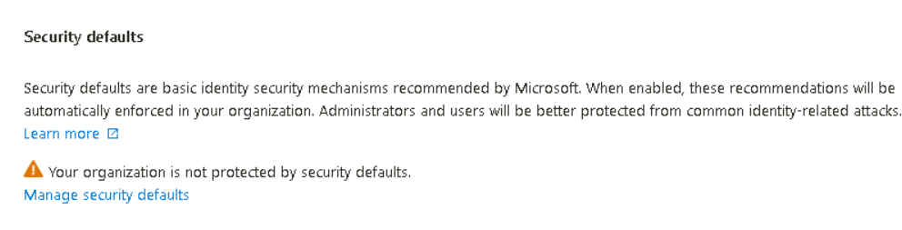
*Figure 1 – Security defaults disabled.*

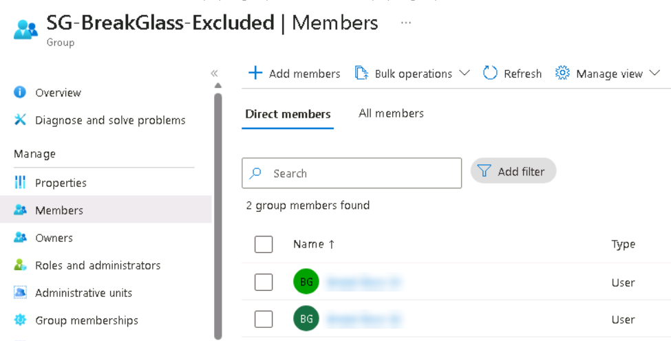
*Figure 2 – Break-glass exclusion group with two members (account names blurred).*

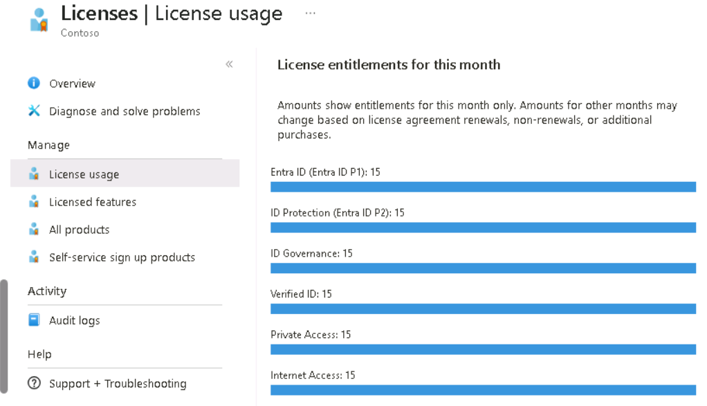
*Figure 3 – Entra ID P1 and P2 licences available.*

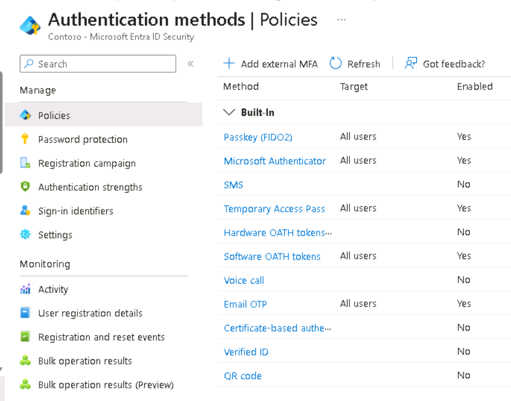
*Figure 4 – Authentication methods enabled for all users.*

**Working method for every Conditional Access policy:** create in **Report-only**, validate with the **What If** tool (admin and standard user), then switch to **On**. Policies were tested and then enabled one at a time.

## Conditional Access policies

All Conditional Access policies target **All resources** and exclude only `SG-BreakGlass-Excluded`.

### 01 – Require MFA for administrators (CA001)

CA001 requires multifactor authentication for 14 privileged directory roles, so a stolen admin password alone no longer grants access to the entire tenant.

| Setting | Value |
| --- | --- |
| Name | `CA001-Require-MFA-Admins` |
| Include | 14 directory roles (Global, Application, Authentication, Billing, Cloud Application, Conditional Access, Exchange, Helpdesk, Password, Privileged Authentication, Privileged Role, Security, SharePoint and User Administrator) |
| Exclude | `SG-BreakGlass-Excluded` |
| Grant | Require multifactor authentication |

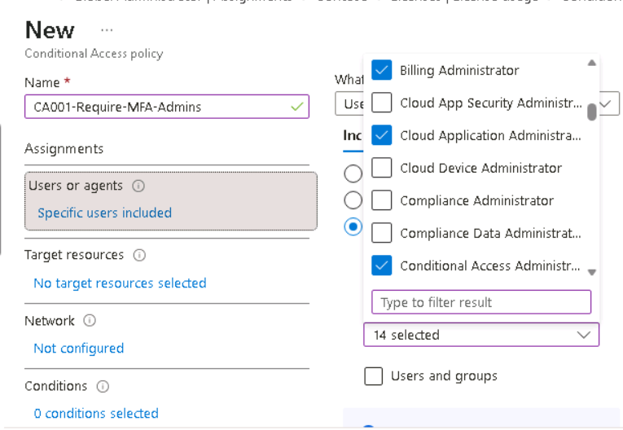
*Figure 5 – CA001 targets 14 administrative roles.*

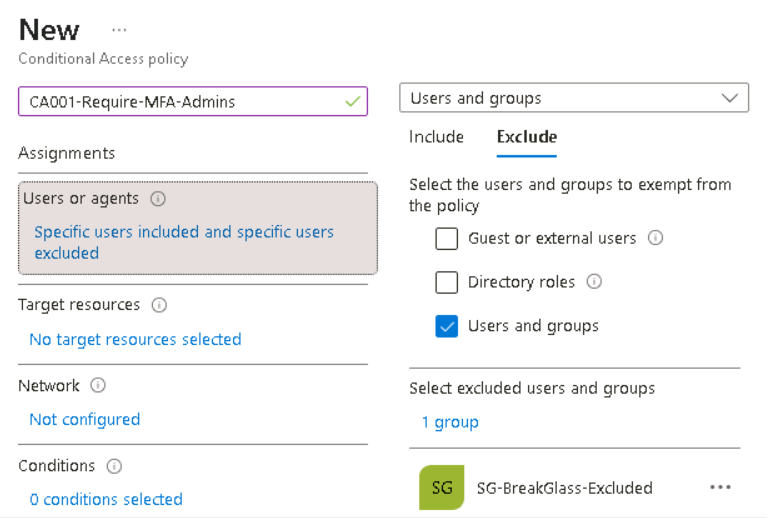
*Figure 6 – Only the break-glass group is excluded.*

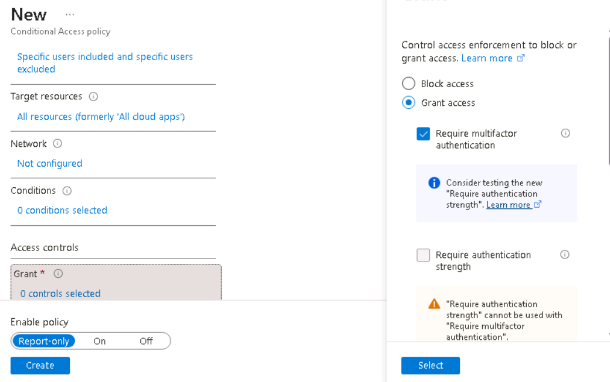
*Figure 7 – Grant control: require MFA. Require authentication strength cannot be combined with it. Once the company baseline is set, an upgrade to more phishing-resistant MFA should be implemented with "require authentication strength".*

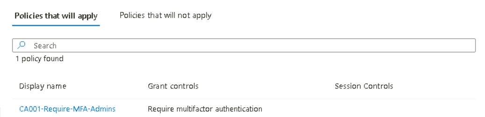
*Figure 8 – What If for an administrator: CA001 applies.*

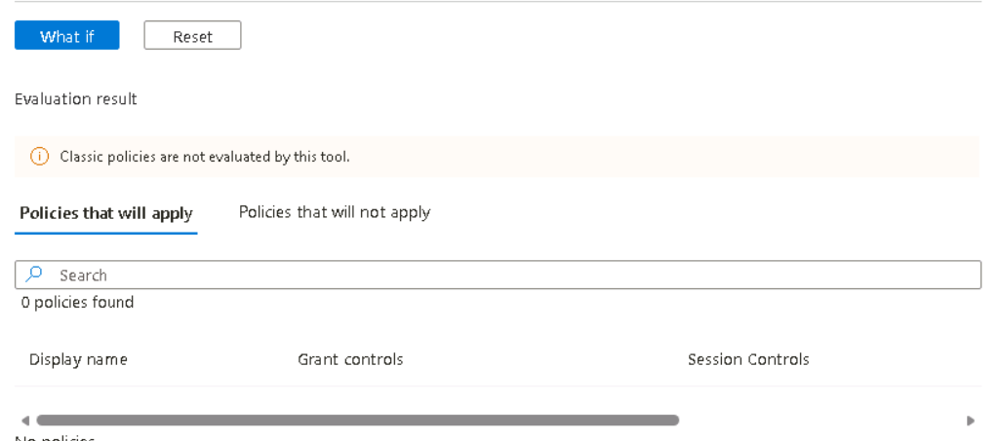
*Figure 9 – What If for a standard user before CA002: 0 policies apply, which shows the gap control 02 closes.*

### 02 – Enforce MFA for all users (CA002)

CA002 extends MFA to every user, which blocks password spray and credential-stuffing attacks against regular accounts.

| Setting | Value |
| --- | --- |
| Name | `CA002-Require-MFA-All-Users` |
| Include | All users |
| Exclude | `SG-BreakGlass-Excluded` |
| Grant | Require multifactor authentication |

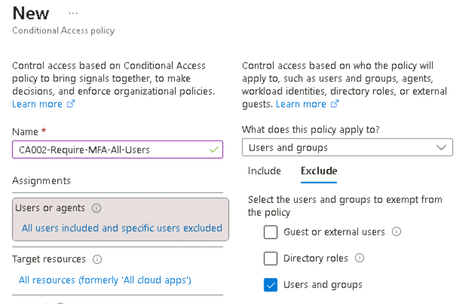
*Figure 10 – CA002 applies to all users.*

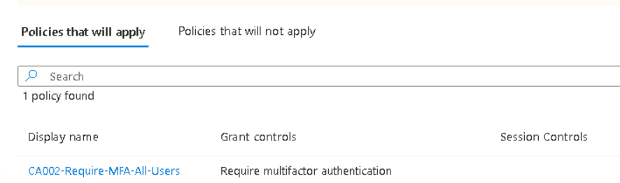
*Figure 11 – What If for a standard user: CA002 now applies.*

### 03 – Block legacy authentication (CA003)

CA003 blocks Exchange ActiveSync and other legacy clients. These protocols cannot perform MFA, so leaving them open would bypass CA001 and CA002.

| Setting | Value |
| --- | --- |
| Name | `CA003-Block-Legacy-Authentication` |
| Include | All users |
| Exclude | `SG-BreakGlass-Excluded` |
| Client apps | Exchange ActiveSync clients, Other clients (Browser and Mobile/desktop left unchecked) |
| Grant | Block access |

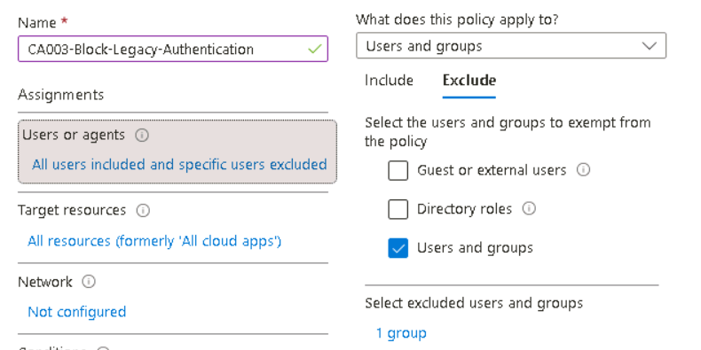
*Figure 12 – CA003 assignments.*

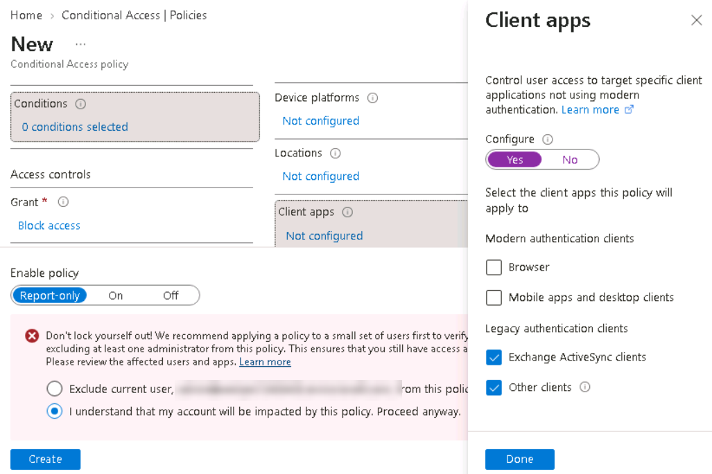
*Figure 13 – Only legacy client apps are targeted (the admin UPN is blurred).*

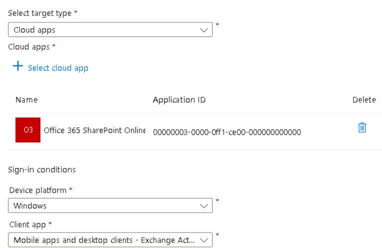
*Figure 14 – What If input: Exchange ActiveSync client.*

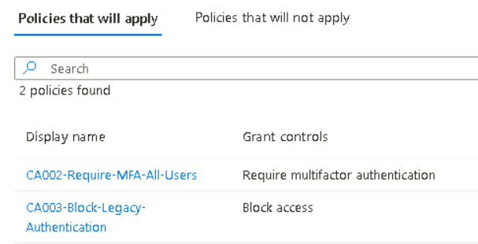
*Figure 15 – Legacy sign-in is blocked by CA003.*

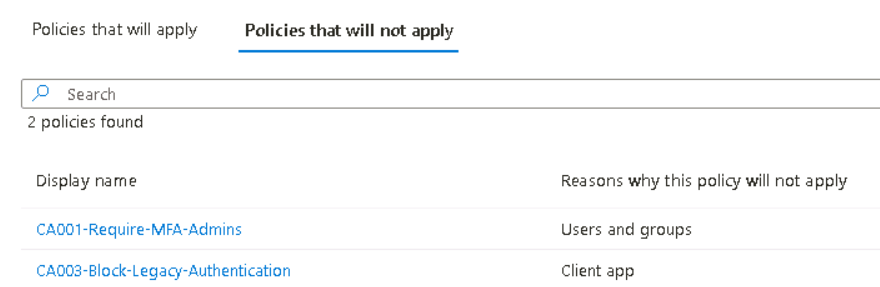
*Figure 16 – A modern browser sign-in is not affected by CA003.*

### 04 – Challenge risky sign-ins (CA004)

CA004 forces an MFA prompt when ID Protection rates a sign-in as medium or high risk, such as an unfamiliar location or a known malicious IP address.

| Setting | Value |
| --- | --- |
| Name | `CA004-Require-MFA-Medium-High-SignIn-Risk` |
| Include / Exclude | All users / `SG-BreakGlass-Excluded` |
| Condition | Sign-in risk: High, Medium |
| Grant | Require multifactor authentication |
| Session | Sign-in frequency: Every time |

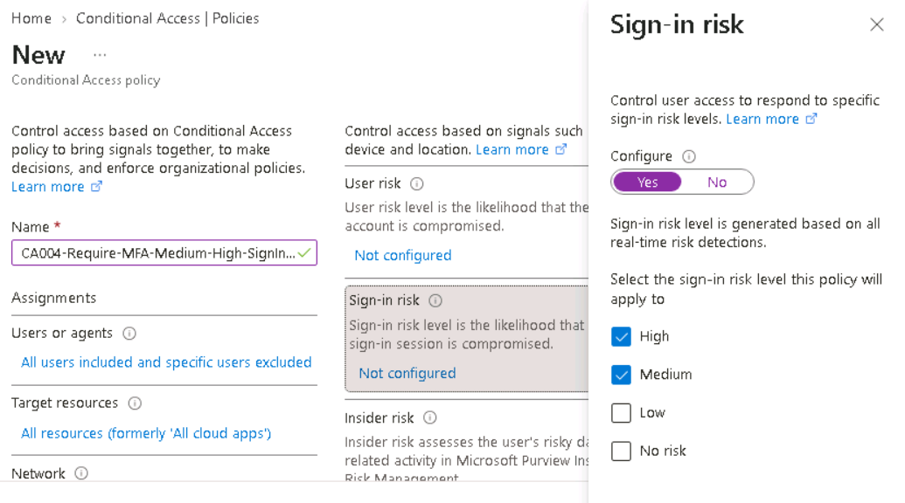
*Figure 17 – CA004 sign-in risk levels.*

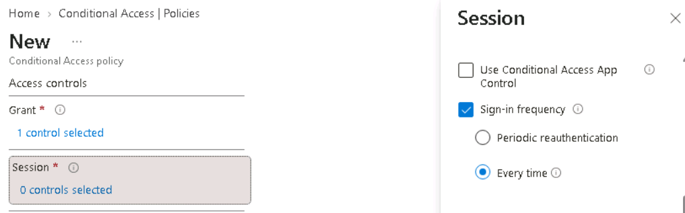
*Figure 18 – Session control: reauthenticate every time.*

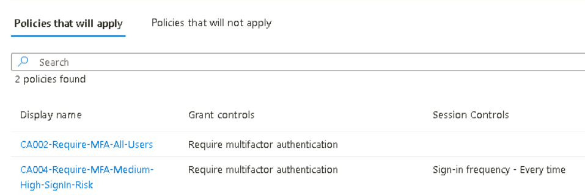
*Figure 19 – What If with medium sign-in risk: CA004 applies.*

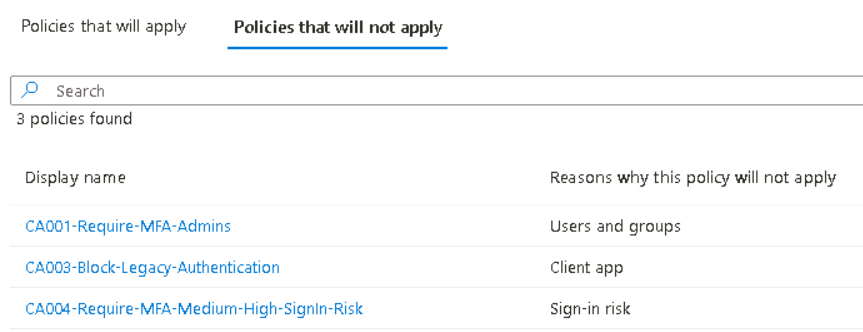
*Figure 20 – What If with low sign-in risk: CA004 does not apply.*

### 05 – Remediate high-risk users (CA005)

CA005 makes a user whose account is likely compromised prove their identity with MFA and set a new password before they can continue, which removes the attacker's known credential.

| Setting | Value |
| --- | --- |
| Name | `CA005-Remediate-High-User-Risk` |
| Include / Exclude | All users / `SG-BreakGlass-Excluded` |
| Condition | User risk: High |
| Grant | Require MFA **and** require password change (require all selected controls) |
| Session | Sign-in frequency: Every time |

Sign-in risk and user risk are kept in separate policies.

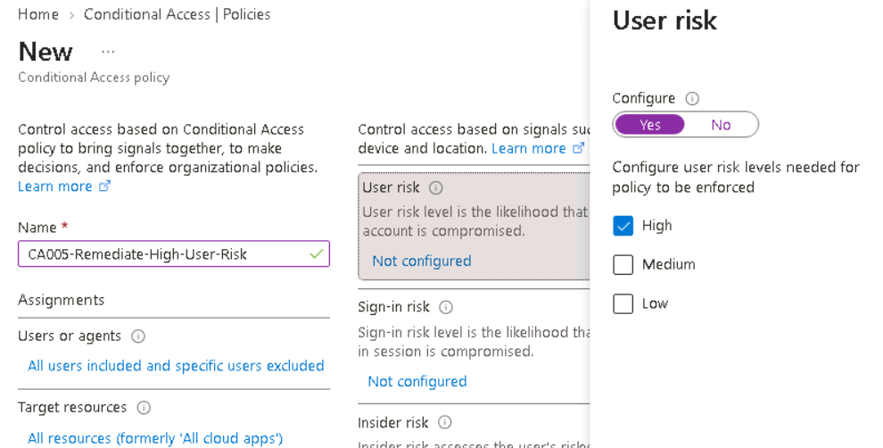
*Figure 21 – CA005 user risk level.*

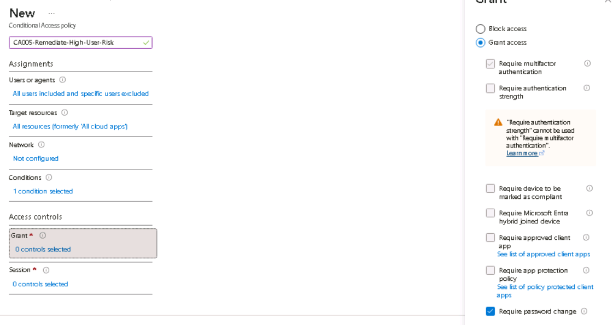
*Figure 22 – Grant controls for CA005.*

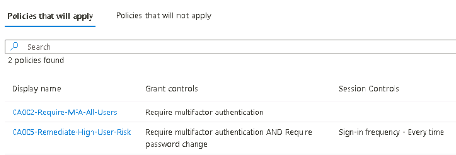
*Figure 23 – What If with high user risk: CA005 applies.*

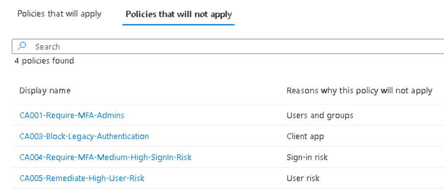
*Figure 24 – What If with no user risk: CA005 does not apply.*

## Application, Teams & password controls

### 06 – Restrict application consent

Users can no longer grant third-party apps access to company data, which stops consent-phishing attacks. They can still request an app through an admin consent workflow.

| Setting | Value |
| --- | --- |
| User consent for applications | Do not allow user consent |
| Users can request admin consent | Yes |
| Reviewers | 1 user (MOD Administrator) |
| Email notifications / reminders | Yes / Yes |
| Request expires after | 30 days |

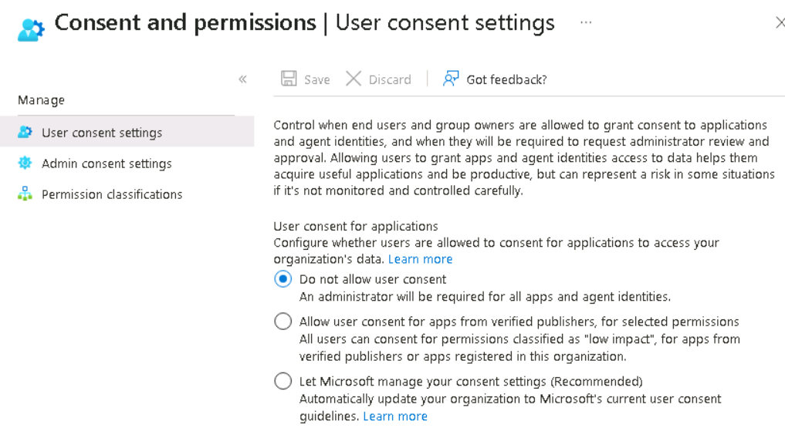
*Figure 25 – User consent disabled.*

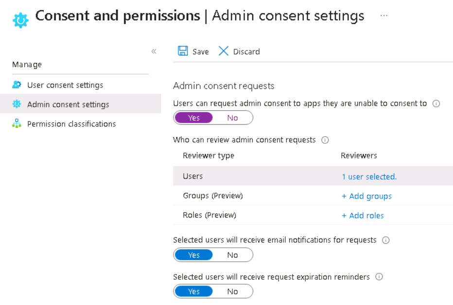
*Figure 26 – Admin consent workflow enabled.*

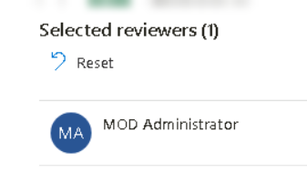
*Figure 27 – Selected reviewer.*

### 07–09 – Teams meeting controls

The three Teams controls were set in the **Global (Org-wide default)** meeting policy in the Teams admin center. Together they stop uninvited or anonymous people from entering meetings and from taking over the screen.

| # | Control | Setting | Value |
| --- | --- | --- | --- |
| 07 | Lobby access | Who can bypass the lobby | People who were invited |
| 08 | Presenter privileges | Who can present | Only organizers and co-organizers |
| 09 | Anonymous access | Anonymous users can join a meeting unverified | Off |

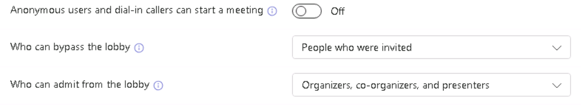
*Figure 28 – Control 07: only invited people bypass the lobby.*

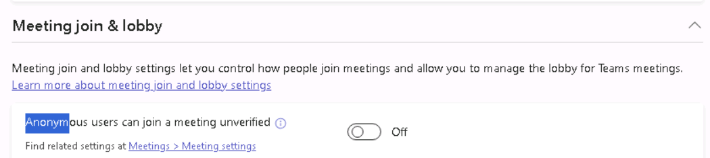
*Figure 29 – Control 09: anonymous join switched Off.*

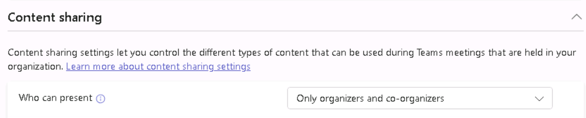
*Figure 30 – Control 08: only organizers and co-organizers can present.*

### 10 – Self-service password reset

SSPR is enabled for all users, so a locked-out user can recover securely with two verified methods instead of calling a helpdesk. More authentication methods are enabled (see figure 4) than the two required to reset, so every user can meet the requirement.

| Setting | Value |
| --- | --- |
| Self service password reset enabled | All |
| Number of methods required to reset | 2 |
| Require users to register when signing in | Yes |
| Days before re-confirming authentication info | 180 |
| Notify users on password resets | Yes |
| Notify all admins when other admins reset | Yes |

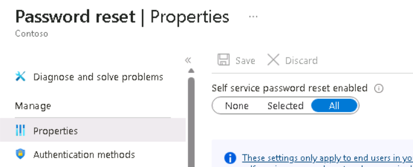
*Figure 31 – SSPR enabled for all users.*

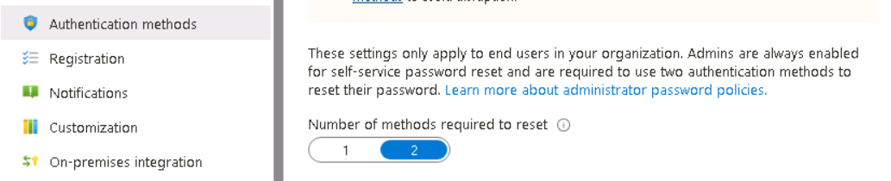
*Figure 32 – Two methods required.*

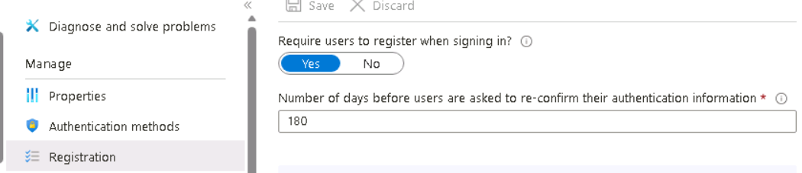
*Figure 33 – Registration enforced.*

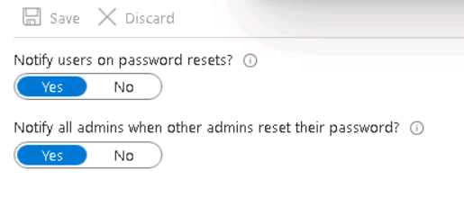
*Figure 34 – Reset notifications enabled.*

## Verification and results

The assessment script confirmed all 10 recommendations as **IMPLEMENTED** on 20 October 2026 at 12:16 UTC, with 0 not configured and 0 unknown.

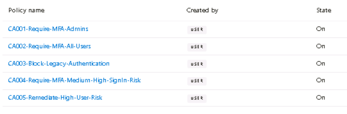
*Figure 35 – Final state: CA001–CA005 all On.*

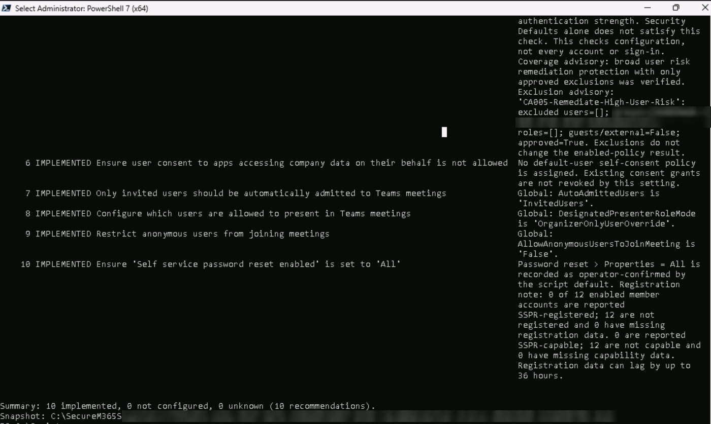
*Figure 36 – Assessment script summary: 10 implemented, 0 not configured, 0 unknown. The group object ID and the tenant ID in the snapshot path are blurred.*
